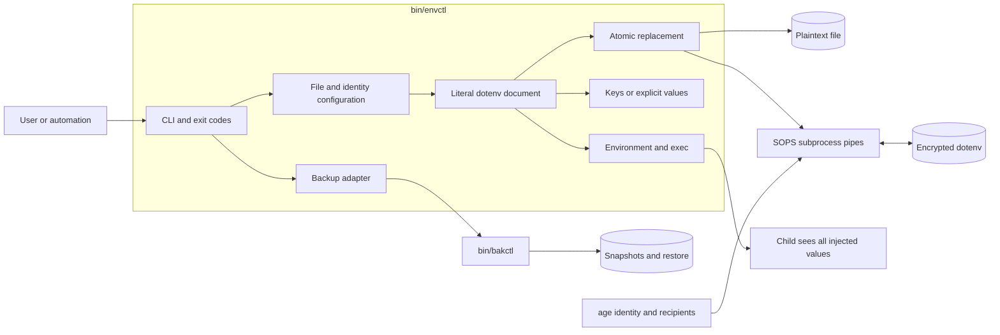
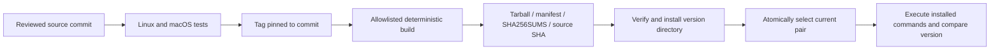

# Architecture

Logical components remain in two executable Python files; this is not a package
or modular rewrite. Both commands are versioned and installed together.

| Component | Implementation | Contract |
|---|---|---|
| CLI | `main`, `cmd_*` | Commands, validation, exit codes; `--version` identifies paired version |
| Configuration | `ENVCTL_FILE`, `SOPS`, `AGE_KEY_FILE`, `_sops_config` | Explicit file, SOPS executable, identity, adjacent recipient config |
| Document | `_find`, `_kv`, set/unset | Literal lines; preserves unrelated lines; no shell evaluation |
| Storage | `_load`, `_write`, `_mutation_lock` | 0600 new files; existing modes retained; atomic replacement; cooperating writers serialized |
| SOPS adapter | `_sops_decrypt`, `_sops_encrypt_write` | Encrypt via pipe; decrypt candidate and compare before replacing original |
| Backup adapter | `_backup`, history/restore | Resolve real script path to same-directory bakctl; ciphertext snapshots for `.enc` |
| Runner/output | exec/get/export/list | exec inherits and injects; get/export reveal; list prints key names |

Repository layout: `bin/` commands, `tests/` synthetic tests, `scripts/` build and
install helpers, `docs/` contracts, `examples/` synthetic configuration, and
`.github/workflows/` CI and release gates. External secret stores, synchronization,
node enrollment, and deployment systems belong to consumers.
